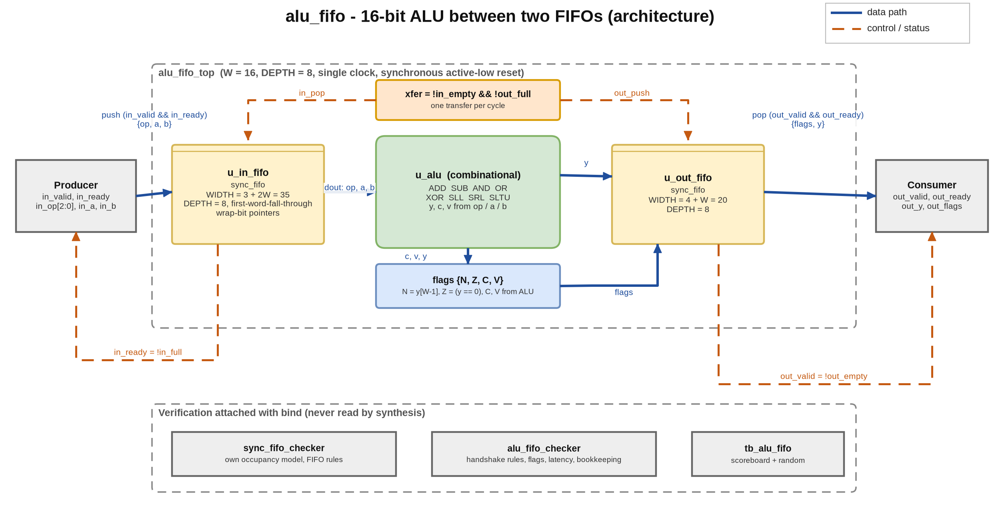
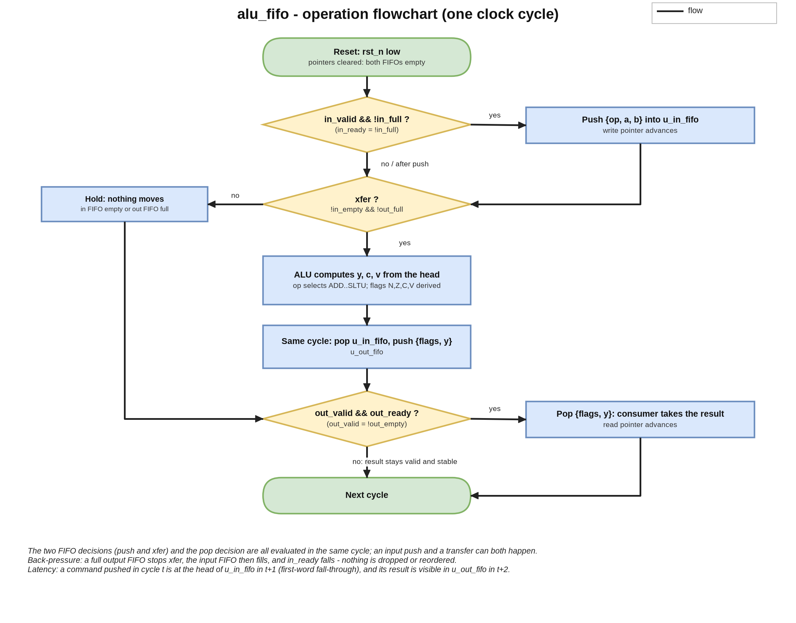
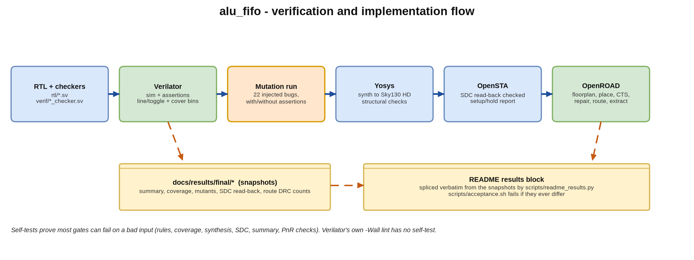

## A. Project overview

### A.1 Purpose

`alu_fifo` is a small clocked datapath: a 16-bit ALU between an input FIFO and an output FIFO, with valid/ready handshakes on both
sides. It's written in SystemVerilog, and I took it from RTL through simulation-based verification (Verilator), synthesis (Yosys),
static timing (OpenSTA) and place and route (OpenROAD) on the Sky130 HD standard cells. I kept it small on purpose, so that every stage of
the flow and every check in it can be inspected and shown to be able to fail.

### A.2 Problem statement and motivation

Compute units in real designs rarely talk to their neighbours directly. Operands arrive through queues, results leave through queues, and
the unit has to keep its data correct when either side stalls. This project deals with three things that are each simple on their own but
fail in typical ways when they're combined: (1) a synchronous FIFO whose full and empty logic has to be exact, (2) an ALU whose flags have
to match its result, and (3) the back-pressure rule that stops the ALU when the output queue is full, without dropping, duplicating or
reordering a command.

The second goal is the evidence trail. I wanted a flow in which no reported number is typed by hand, every check has a test showing it can
fail, and the implementation runs all the way to a routed, extracted design.

### A.3 Scope and requirements

| ID | Requirement |
|---|---|
| R1 | 8-operation combinational ALU (ADD, SUB, AND, OR, XOR, SLL, SRL, SLTU) with flags N, Z, C, V |
| R2 | Single-clock synchronous FIFOs, power-of-two depth, first-word-fall-through read, wrap-bit pointers |
| R3 | One transfer per cycle whenever the input FIFO has a command and the output FIFO has room |
| R4 | Commands are never lost, duplicated or reordered, under any pattern of back-pressure |
| R5 | Parameterised data width `W` and FIFO `DEPTH` (defaults 16 and 8) |
| R6 | Verified by an independent scoreboard, bound assertions, coverage and an injected-bug campaign |
| R7 | Synthesised, timed and placed-and-routed on Sky130 HD, with the setup slack met after routing |

Out of scope: more than one clock, SRAM macros, formal proofs, sign-off DRC/LVS, corners other than typical, and any data width other than
16 in the verification (the parameter exists and the RTL is width-generic, but only `W = 16` is verified).

### A.4 Target application and concepts

It's a building block for a streaming compute pipeline, where an execution unit sits behind an issue queue and in front of a result queue.
Along the way it covers valid/ready handshakes, FIFO pointer design, flag generation, the overflow (V) and carry (C) conventions,
back-pressure, verification with bound assertions, coverage closure, mutation analysis, constraint-driven synthesis, static timing, timing
repair and routing.

### A.5 Key features and measurable objectives

- One transfer per cycle in steady state, and two cycles of latency from a push to a visible result (section F).
- 15 labelled assertions in checkers attached with `bind`, 34 named cover bins, and a mutation run in which each of 22 injected bugs has to
  be caught by the check it's bound to.
- Objective: routed setup slack >= 0 at the 10 ns target, with zero DRC and antenna violations (section H).

---

## B. Architecture and block diagram

### B.1 Overview

There are three RTL files, `alu_pkg.sv` (opcodes and flag indices), `sync_fifo.sv` (one FIFO) and `alu.sv` (the ALU), and `alu_fifo_top.sv`
puts them together. A command `{op, a, b}` (3 + 2W bits) goes into the input FIFO, and the ALU reads the head of that FIFO combinationally.
Its result `{flags, y}` (4 + W bits) is written into the output FIFO in the same cycle the command leaves the input FIFO. There's no pipeline
register between the FIFOs; the two FIFOs are the pipeline.

### B.2 Modules and responsibilities

| Module | Responsibility |
|---|---|
| `alu_pkg` | opcode encodings (`OP_W` = 3 bits), flag indices `{N, Z, C, V}` |
| `sync_fifo` | storage (`WIDTH` x `DEPTH` flip-flops), wrap-bit write/read pointers, `full`/`empty`, first-word-fall-through `dout` |
| `alu` | purely combinational ADD, SUB, AND, OR, XOR, SLL, SRL, SLTU; outputs result `y`, carry `c`, overflow `v` |
| `alu_fifo_top` | the transfer rule, flag derivation (N, Z), concatenation of the FIFO words, the `in_ready` / `out_valid` logic |
| `sync_fifo_checker`, `alu_fifo_checker` | bound assertions and cover points (simulation only) |
| `tb_alu_fifo` | testbench: reference model, directed and random stimulus, random back-pressure |

### B.3 Interfaces

| Signal | Dir | Width | Meaning |
|---|---|---:|---|
| `clk`, `rst_n` | in | 1 | clock, synchronous active-low reset |
| `in_valid` / `in_ready` | in / out | 1 | producer handshake; `in_ready = !in_full` |
| `in_op` | in | 3 | operation select |
| `in_a`, `in_b` | in | W | operands |
| `out_valid` / `out_ready` | out / in | 1 | consumer handshake; `out_valid = !out_empty` |
| `out_y` | out | W | result |
| `out_flags` | out | 4 | `{N, Z, C, V}`; on SUB, C = 1 means no borrow |

### B.4 Data and control paths

**Data path**: `in_{op,a,b}` -> `u_in_fifo` -> ALU -> flag logic -> `u_out_fifo` -> `out_{flags,y}`. **Control path**:
`xfer = !in_empty && !out_full` drives `in_pop` and `out_push` together, `in_ready` and `out_valid` come straight from the FIFO flags,
`in_push` is `in_valid && in_ready` and `out_pop` is `out_valid && out_ready`. There's no FSM; the control state is just the four pointers.

---

## C. Draw.io architecture diagram



The diagram files are in `docs/portfolio/diagrams/`: `alu_fifo_architecture.drawio` (the editable source), `.png` (a 2x export) and `.svg`,
plus `alu_fifo_flowchart.*` and `alu_fifo_flow.*` (the verification and implementation flow). `dgm.py`, next to the diagram script, generates the images and the
`.drawio` files from one specification; the images are drawn with matplotlib, not exported from the draw.io application.

---

## D. Design flowchart



The flowchart shows one clock cycle. After reset both FIFOs are empty. In every cycle three independent decisions are made: whether the
producer pushes (`in_valid && !in_full`), whether a transfer happens (`!in_empty && !out_full`), and whether the consumer pops
(`out_valid && out_ready`). Because they're independent, a push, a transfer and a pop can all happen in the same cycle, and that's what gives
one operation per cycle in steady state.



---

## E. Detailed design explanation

### E.1 The FIFO

`sync_fifo` stores `DEPTH` words in flip-flops and keeps `AW + 1`-bit pointers (`AW = log2(DEPTH)`). The extra top bit of each pointer is
the wrap bit. The FIFO is **empty** when the pointers are equal, and **full** when the low bits are equal and the wrap bits differ. A write
happens on `push && !full` and the read pointer advances on `pop && !empty`. Both guards are inside the FIFO, so a badly driven handshake
can't corrupt the pointers. `dout` is the word at the read pointer, so the head of the queue is visible without a read cycle
(first-word-fall-through). `DEPTH` has to be a power of two >= 2, which is checked at elaboration.

### E.2 The ALU and its flags

`sum = {0,a} + {0,b}` and `diff = {0,a} + {0,~b} + 1` are formed with one extra bit. ADD returns `sum[W-1:0]`, with `C = sum[W]` and
`V = (a[W-1] == b[W-1]) && (sum[W-1] != a[W-1])`. SUB returns `diff[W-1:0]`, with `C = diff[W]` (so C = 1 means *no borrow*) and
`V = (a[W-1] != b[W-1]) && (diff[W-1] != a[W-1])`. AND, OR and XOR are bitwise, SLL and SRL shift by `b[log2(W)-1:0]`, and SLTU returns 1
if `a < b` unsigned. For the logical operations C and V are 0. `alu_fifo_top` adds `N = y[W-1]` and `Z = (y == 0)`. The `unique case`
turns an unspecified opcode into a simulation error instead of letting it pass silently.

### E.3 Reset, latency, throughput, back-pressure and errors

- **Reset**: synchronous and active-low. It clears the four pointers, so both FIFOs are empty. The storage isn't reset, since it's never
  read before it's written.
- **Latency**: a command pushed in cycle t is at the head of the input FIFO in t+1 (first-word fall-through), moves to the output FIFO at
  the end of t+1, and its result is visible at the output in t+2. That's two cycles from push to a visible result.
- **Throughput**: one operation per cycle when neither side stalls.
- **Back-pressure**: if the consumer doesn't take results, the output FIFO fills, `xfer` stops, the input FIFO fills and `in_ready` falls.
  No command is dropped.
- **Errors**: pushing into a full FIFO or popping an empty one is prevented structurally by the guards, and the checkers fire if the
  logic around them ever tries.

### E.4 Design decisions and trade-offs

| Decision | Alternative | Reason / cost |
|---|---|---|
| Combinational ALU between the FIFOs | register the ALU result before the output FIFO | the output FIFO is already a register; a second stage adds latency for no gain at this width. The cost is a longer path (section H) |
| Flip-flop storage | SRAM macro | no macro in the open PDK flow used; depth 8 is small |
| Wrap-bit pointers | counter + flags | the standard exact full/empty test without an occupancy counter |
| Assertions in bound checkers | assertions inside the RTL | synthesis never sees them; the RTL stays readable |
| 10 ns target with a 0.3 ns setup margin in `repair_timing` | no margin | without a margin the repair stops at zero slack on placement-stage wire estimates and the routed design missed |

---

## F. Interface and timing details

### F.1 Clocking and reset

One clock, rising-edge flops, a synchronous reset and no clock-domain crossing.

### F.2 Handshakes

A producer transfer happens on a rising edge where `in_valid && in_ready`, and a consumer transfer where `out_valid && out_ready`.
`in_ready` and `out_valid` only depend on the FIFO flags, never on `in_valid` or `out_ready`, so the interface has no combinational
valid-to-ready loops. The producer has to hold `in_valid` and the command stable until they're accepted. The testbench has a protocol
monitor for that rule and a testbench mutant that breaks it.

### F.3 Timing constraints used (constraints/alu_fifo.sdc)

The period comes from `CLK_PERIOD_NS` (10 ns). The input and output delays are 20 % of the period on every non-clock port, the input
driving cell is `buf_2` and the output load is 0.01 pF. These are assumptions about the surrounding system, and `scripts/check_sdc.py`
compares the constraints that were written with OpenSTA's read-back to make sure they're the ones that were loaded.

### F.4 Supported conditions and limitations

Only `W = 16` is verified (the RTL is generic), only the typical corner is timed, and the power figure is OpenSTA's default-activity
estimate rather than a workload measurement.

---

## G. Verification and testing

### G.1 Objectives and test plan

Show that (1) every result equals an independent reference, (2) the handshake and FIFO rules hold in both directions ("only when" and
"whenever"), (3) the stimulus reaches every interesting state, and (4) each check can fail.

### G.2 Testbench architecture

`tb_alu_fifo` has a scoreboard against an independent reference model, which is itself checked against hand-derived known answers before
any stimulus is applied. It runs directed corner cases for every operation, fill and drain and pointer wrap, a seeded random phase with
random back-pressure on both sides, and a reset in the middle of traffic. Verilator is two-state, so idle data is randomised and garbage is
driven whenever `valid` is low, which makes a design that samples data without its valid fail. The only C++ is `verif/sim_main.cpp` (about
twenty lines), because the main that Verilator 5.020 generates never writes `coverage.dat`.

### G.3 Assertions and properties

There are 15 labelled assertions in `verif/sync_fifo_checker.sv` and `verif/alu_fifo_checker.sv`. `a_full_def`, `a_empty_def`,
`a_not_full_and_empty`, `a_head_stable`, `a_conservation` and `a_reset_empty` are the FIFO rules, checked against the checker's own
occupancy model. `a_ready_def`, `a_valid_def` and `a_xfer_def` are the handshake rules: ready and valid are exactly the FIFO flags, and a
transfer happens whenever one is possible and only then. `a_in_hold` and `a_out_hold` keep held data stable, and `a_flag_n`, `a_flag_z`,
`a_lockstep` and `a_latency` cover flag consistency, lock-step bookkeeping and latency. The scoreboard checks data values; the assertions
don't. Verilator 5.020 has no `##` sequence delays and no covergroups, so the properties use `|->`, `|=>`, `$past` and `$stable`, and the
functional coverage is named `cover property` bins plus line and toggle coverage.

### G.4 Coverage

```text
source               : build/cov_d8/coverage.dat
named cover bins     : 34 total, 34 hit, 0 zero
rtl/ line blocks    : 10 total, 10 covered, 0 excluded, 0 uncovered
rtl/ files with no line records : alu_fifo_top.sv, alu_pkg.sv (procedural blocks only are recorded; these are covered by toggle coverage, the cover bins and the assertions, not by the line gate)
rtl/ branches       : 12 total, 12 hit (reported, not gated)
rtl/ toggle bits    : 626 total, 626 toggled, 0 unhit (reported, not gated)
```

### G.5 Checking the checks

```text

mutants: 22, killed 22, intended check fired in 22
only guard for their bug (survive with the intended check removed): M15, M17
assertions defined in verif/*_checker.sv : 15
assertions with no mutant bound to them  : none
assertions that fired in no mutant run   : none
```

Each of the 22 mutants is one deliberate bug: full asserted early, a pop while empty, a push while full, a reset that leaves a pointer
alone, a wrong ALU flag, a throughput bug such as a half-rate source, a testbench-side mutant that breaks the source protocol, and so on.
Each one is bound to the check it has to trip, and is also run with that assertion removed, to see whether another check still catches it.
The harness fails if any assertion has no mutant bound to it or never fired. The self-tests (`rules-selftest`, `cov-selftest`,
`sta-selftest`, `synth-selftest`, `summary-selftest`, `pnr-selftest`) show that most of the gates reject a bad input.

### G.6 Simulation commands and tool requirements

```bash
make check   # lint, RTL style gate, simulation, seeds, depths 2/4/16, coverage, mutation run and the self-tests
make all     # synth + sta + pnr
```

Tools: Verilator 5.020, Yosys 0.33, OpenSTA, OpenROAD (v2.0-25346), Python 3 and make. klayout, magic and netgen aren't available, so
there's no sign-off DRC/LVS.

### G.7 Known failures

None in the delivered configuration. What isn't verified: `W != 16`, and formal properties.

---

## H. Synthesis, timing and performance results

All the figures below are quoted word for word from `docs/results/final/summary.txt`, the same report snapshot that
`scripts/readme_results.py` quotes in the README.

```text
=== SUMMARY (every line is read from a report file) ===
[synthesis]  build/reports/stat.txt
  cells                              Number of cells:               1625
  area (um^2, no placement)          Chip area for module '\alu_fifo_top': 19947.881600
[static timing, post-synthesis, ideal clock, no wires]  build/reports/timing.txt
  clock period (ns)                  clock period (from the loaded design): 10.000000 ns
  worst setup slack (ns)             worst slack max -2.536
  worst hold slack (ns)              worst slack min 0.427
  total negative slack (ns)          tns max -146.371
[place and route, routed + extracted (SPEF), propagated clock]  pnr_results/
  clock period used (ns)             clock_period_ns=10.000000
  repair_timing setup margin         repair_setup_margin=0.3
  worst setup slack (ns)             worst slack max 0.061
  worst hold slack (ns)              worst slack min 0.493
  total negative slack (ns)          tns max 0.000
  slew/cap/fanout, routed            max slew 0, max capacitance 0, max fanout 0 (violating pins/nets)
  slew/cap/fanout, after repair      max slew 0, max capacitance 0, max fanout 0 (violating pins/nets)
  clock skew                          -0.059 setup skew
  design area                        Design area 20825 u^2 42.4% utilization (standard cells and tapcells, before filler cells)
  total power (W, default activity)  Total                  4.14e-03   3.66e-03   8.71e-09   7.80e-03 100.0%
  route DRC violations               drc_violations=0
  antenna violations                 antenna_violations=0
===
```

How to read the numbers:

- **The post-synthesis timing (pre-layout) doesn't close at 10 ns.** The clock is ideal, wires cost nothing and high-fan-out nets aren't
  buffered (the FIFO read pointers drive every bit of the read multiplexer), so this figure is pessimistic. I show it as measured.
- **The number that matters is the routed and extracted one.** After placement, clock-tree synthesis, `repair_timing` and detailed
  routing, with extracted parasitics and a propagated clock, the setup slack is positive (second block). Closing it took a 0.3 ns setup
  margin in `repair_timing`.
- The area (standard cells and tapcells, before filler cells) and power (at OpenSTA's default activity) are as listed. OpenROAD's own DRC
  and antenna checks report zero violations, and there's no sign-off DRC/LVS.

| Item | Status |
|---|---|
| Synthesis area and cell count, post-synthesis STA, routed STA, routed area, route DRC/antenna counts | measured (above) |
| Power | estimate at default switching activity (not a workload measurement) |
| Maximum frequency | NOT MEASURED as a figure: the project closes timing at a 10 ns target; no period sweep was run |
| Sign-off DRC/LVS, other corners | NOT MEASURED (tools not installed / not run) |

---

## I. Results, limitations and future improvements

### I.1 Summary

All 15 assertions hold, all 34 cover bins are hit, all 22 injected bugs are caught by the check they're meant for, and the design is routed
with positive setup slack and zero DRC and antenna violations.

### I.2 Most meaningful outcomes

1. A verification environment that's been shown to catch *throughput* bugs (a half-rate source, results held back) as well as data bugs,
   because each handshake rule is checked in the "whenever" direction as well as the "only when" one.
2. A flow whose reported figures are quoted from checked-in snapshots, and whose gates are shown to fail on bad input.
3. A straight account of the timing: a pessimistic pre-layout number, the routed number that matters, and the setup margin that made the
   difference.

### I.3 Limitations

Only `W = 16` is verified; there are no formal proofs and no sign-off DRC/LVS; only the typical corner is timed; power is at default
activity; the storage is flip-flops, with no macros; and twelve minor findings I deferred are listed in `docs/rulings.md`.

### I.4 Future improvements

Formal proofs of the FIFO and handshake rules (SymbiYosys); a registered ALU stage, with the frequency and latency trade-off measured;
verification at other widths and depths; multi-corner timing; a period sweep to find the maximum routed frequency; and sign-off DRC/LVS
where the tools are available.

### I.5 Interview talking points

- Why a wrap bit instead of an occupancy counter, and exactly how full and empty are derived.
- Why `in_ready` and `out_valid` only depend on the flags (no combinational ready-to-valid path).
- The "whenever" and "only when" assertion pairs, and the half-rate-source mutant that needed them.
- Why the pre-layout timing fails and the routed timing passes, what the setup margin does, and why it was needed.
- How binding assertions to mutants, and mutants to assertions, keeps the checks honest.

---

## J. References and reproducibility

- IEEE 1800 SystemVerilog (assertions, `bind`); Verilator manual (coverage, assertions); Yosys manual; OpenSTA and OpenROAD documentation;
  SkyWater SKY130 `sky130_fd_sc_hd` liberty.
- The design specification is `docs/superpowers/specs/2026-10-19-alu-fifo-design.md` (the working plan I built it from isn't kept in this
  folder), the decisions are in `docs/rulings.md`, and the report snapshots are in `docs/results/`.
- Directory structure: `rtl/` (alu_pkg, alu, sync_fifo, alu_fifo_top), `verif/` (testbench, checkers, mutants, `sim_main.cpp`), `scripts/`
  (flow, gates, self-tests), `constraints/alu_fifo.sdc`, `config/`, `sky130hd/` (platform), `docs/`.
- To reproduce, run `make check` and then `make all`; `scripts/acceptance.sh` checks the README's results block against the snapshot.
  The source is at https://github.com/AbhijeetJ-512/alu-fifo.
